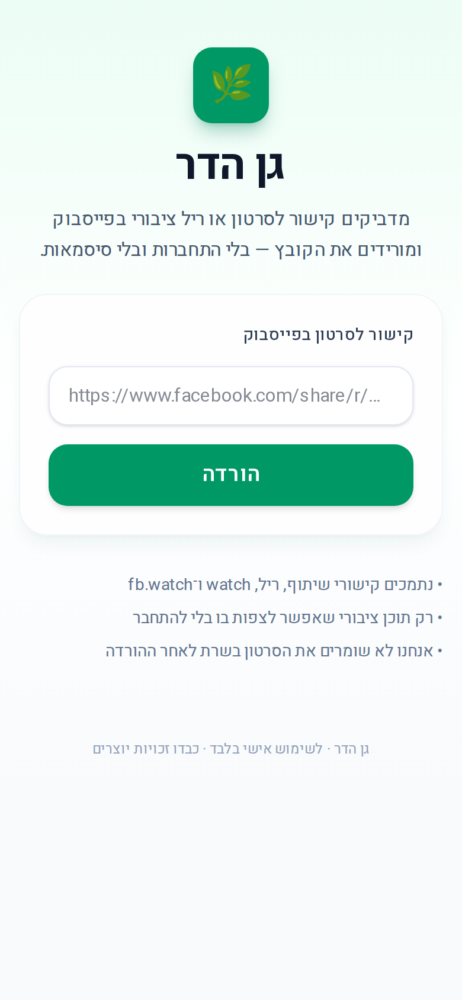
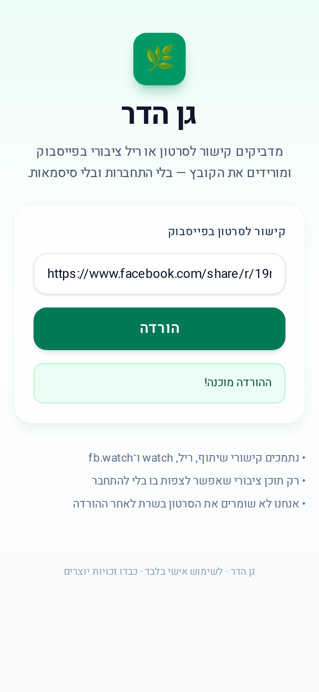
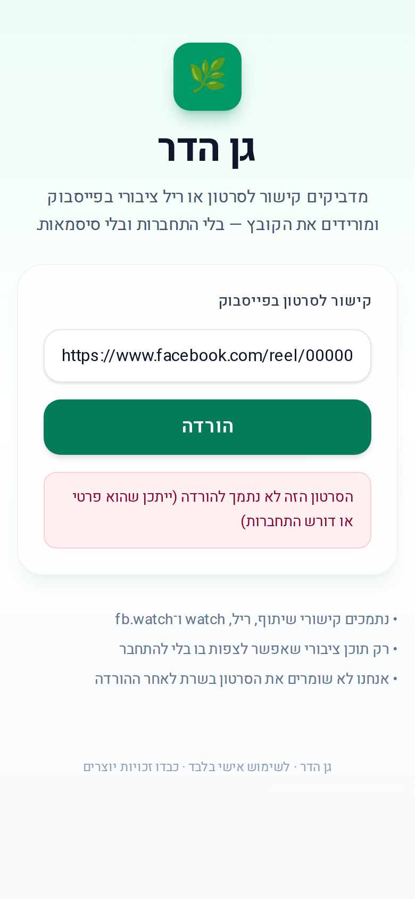

# Gan Hadar (גן הדר)

A small, friendly web app that lets a non-technical user paste a **public** Facebook video/reel/share link and download the MP4 to their computer. The UI is Hebrew, right-to-left, and mobile-friendly.

**Stack:** Next.js (App Router), `yt-dlp`, `ffmpeg` (merge), Node.js API routes. No Facebook cookies or credentials are used.

## Requirements

- Node.js 20+
- `ffmpeg` on your PATH
- `yt-dlp` (or Python 3 with `pip install yt-dlp` — the server falls back to `python3 -m yt_dlp`)

## Run locally

```bash
npm install
# optional: export YT_DLP_PATH=yt-dlp
npm run dev
```

Open [http://127.0.0.1:43123](http://127.0.0.1:43123).

### Production build

```bash
npm run build
npm start
```

`PORT` defaults to `43123`. Optional: `DOWNLOAD_TIMEOUT_MS` (default `120000`).

## Docker

```bash
docker build -t gan-hadar .
docker run --rm -p 43123:43123 gan-hadar
```

## Deploy (Render / Railway / Fly.io)

1. Use this repo with the included **Dockerfile** (recommended), or set build command `npm run build` and start command `npm start`.
2. Install **ffmpeg** and **yt-dlp** on the host if not using Docker (Docker image already includes them).
3. Expose port **43123** (or set `PORT` to the platform’s expected port, e.g. `10000` on Render).
4. No secrets are required for public Facebook videos.

**Render:** New Web Service → Docker → health check path `/`.

**Railway:** Deploy from Dockerfile; set public port to match `PORT`.

**Fly.io:** `fly launch` (uses Dockerfile), `fly deploy`, map `internal_port` to `PORT`.

## API

- `POST /api/download` — JSON `{ "url": "https://..." }` → `{ downloadUrl, fileName, title }` or Hebrew error.
- `GET /api/file/:token` — one-time MP4 download; temp file removed after send.

Protections: Facebook-only URL validation, redirect resolution, per-IP rate limit (~12/min), download timeouts, automatic temp cleanup.

## Supported URLs

Public Facebook links such as `share/r`, `share/v`, `/reel/`, `/watch`, `/videos/`, and `fb.watch` redirects.

Private, login-only, or removed videos return:

> הסרטון הזה לא נתמך להורדה (ייתכן שהוא פרטי או דורש התחברות)

## Screenshots

| Home | Success | Unsupported |
|------|---------|-------------|
|  |  |  |

## Legal

For personal use only. Respect copyright and Facebook’s terms. Only download content you have the right to save.

---

## הוראות קצרות (עברית)

1. התקיני Node.js, ffmpeg ו־yt-dlp (או הריצי עם Docker).
2. בתיקיית הפרויקט: `npm install` ואז `npm run dev`.
3. פתחי בדפדפן: `http://127.0.0.1:43123`
4. הדביקי קישור לסרטון **ציבורי** מפייסבוק ולחצי **הורדה**.

לפריסה בענן: העלי את הפרויקט עם ה־Dockerfile ל־Render / Railway / Fly.io, בלי צורך בסיסמאות פייסבוק.